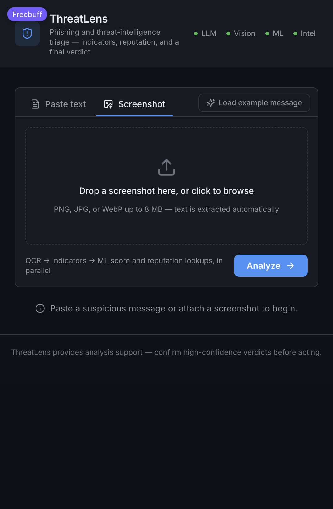
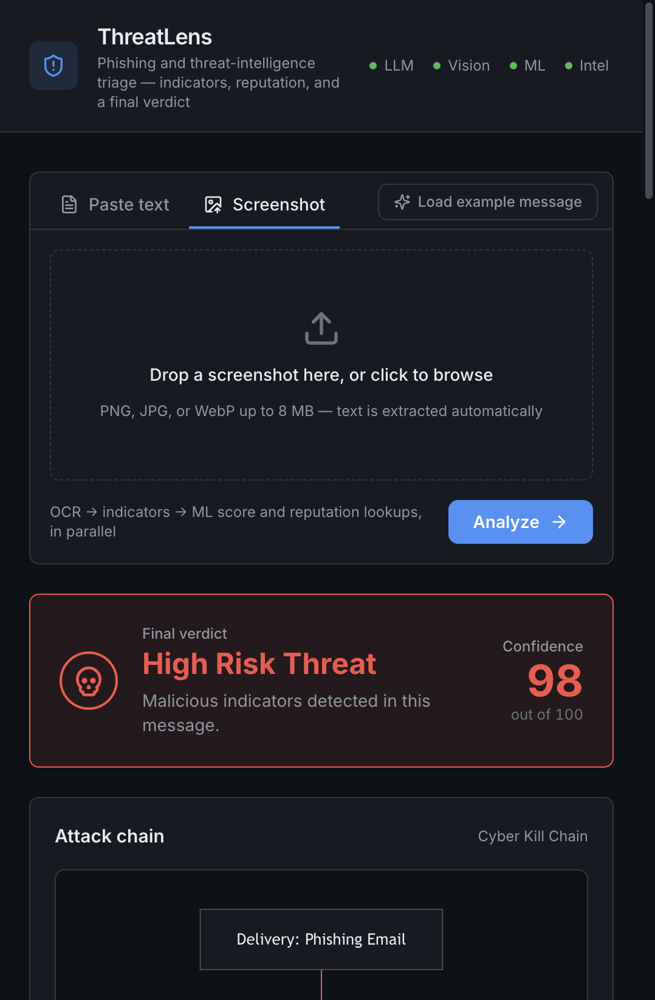

# ThreatLens

Phishing and threat-intelligence triage in one screen. Paste a suspicious email, SMS or chat message — or drop in a screenshot of one — and get back a verdict you can act on: what the message is trying to do, which indicators it contains, what threat intel says about them, and what to do next.





## What it does

- **Reads screenshots.** A screenshot of a phishing text goes through OCR first (Gemini vision, with pytesseract as a fallback) and then through the same pipeline as pasted text.
- **Extracts and defangs indicators.** URLs, bare domains, IPs, email addresses, BTC/ETH/LTC/XMR wallets — everything renders defanged (`hXXp://example[.]com`) so nothing in the report is clickable by accident. Only the backend refangs them, for its own lookups.
- **Checks reputation.** Concurrent VirusTotal v3 lookups for URLs, domains and IPs, rate-limited to fit the free tier (4/min). URLs VT has never seen get submitted for scanning automatically. APIVoid is there as an optional second opinion.
- **Runs a phishing classifier locally.** A DistilBERT model fine-tuned on phishing email scores the text on your machine — that step never sends your message anywhere. A keyword heuristic takes over if the model can't load.
- **Writes the report.** Gemini (OpenAI as automatic fallback) turns the raw evidence into a verdict: a confidence score, the psychological tactics used with quotes from the actual message, reputation findings, numbered remediation steps, and a Mermaid flowchart of the kill chain — or, for false positives, a verification checklist. No LLM key configured? You still get a rule-based report instead of an error.
- **Degrades instead of crashing.** Missing keys switch off that stage and the dashboard says so; the rest of the pipeline keeps working.

## How it fits together

```
 message or screenshot
        │
        ▼
 OCR (vision LLM → pytesseract fallback)          ┐
        │                                          │
        ▼                                          │
 extract indicators + defang                       │  FastAPI backend,
        │                                          │  stages 3 + 4 run
        ├────► ML triage (DistilBERT, local)       │  concurrently
        ├────► OSINT (VirusTotal, APIVoid)         │
        │                                          │
        ▼                                          ┘
 synthesis (Gemini → OpenAI fallback)
        │
        ▼
 verdict JSON  ──►  React dashboard
                    verdict · confidence · tactics · IOCs · flowchart · remediation
```

The backend is FastAPI (`backend/`), the frontend is React + Vite + Tailwind (`frontend/`).

## Getting started

You need **Python 3.9+**, **Node 18+**, and at least one LLM key (for the synthesized report and screenshot OCR).

### 1. Backend

```bash
cd backend
python3 -m venv venv

# install torch first, from the CPU wheel index — otherwise pip may pull
# the ~2 GB CUDA build on Linux
venv/bin/pip install torch==2.2.2 --index-url https://download.pytorch.org/whl/cpu
venv/bin/pip install -r requirements.txt

# create your local config
cp .env.template .env
```

Now put your keys in `backend/.env` (see the table below), then start the API:

```bash
venv/bin/uvicorn main:app --port 8000
```

The first analysis downloads the classifier model from Hugging Face (about 250 MB); after that it runs fully offline if you set `HF_OFFLINE=1`.

### 2. Frontend

```bash
cd frontend
npm install
npm run dev
```

Open **http://localhost:5173**. The dev server proxies `/api` to the backend on port 8000. Hit **“Load example message”** to see a full report without pasting anything.

### 3. Your keys (`backend/.env`)

`.env` is gitignored — keys live only on your machine. Start from the template:

```bash
cp backend/.env.template backend/.env
```

| Variable | What it's for | Where to get it |
|---|---|---|
| `GEMINI_API_KEY` | Report synthesis **and** screenshot OCR | [Google AI Studio](https://aistudio.google.com/app/apikey) — free tier is enough |
| `OPENAI_API_KEY` | Fallback provider when Gemini is unavailable | [OpenAI platform](https://platform.openai.com/api-keys) |
| `VIRUSTOTAL_API_KEY` | URL / domain / IP reputation lookups | [VirusTotal](https://www.virustotal.com) — free, ~4 lookups/min |
| `APIVOID_API_KEY` | Optional second reputation source | [APIVoid](https://www.apivoid.com) |

Everything else in the template already has sensible defaults. Worth knowing:

- The model ids are plain strings — change them in `.env` if you want a different tier (`GEMINI_TEXT_MODEL`, `GEMINI_VISION_MODEL`, `OPENAI_TEXT_MODEL`, `OPENAI_VISION_MODEL`). Google has been retiring older Gemini model ids, so the defaults track whatever is currently available.
- The app auto-detects providers: Gemini first, OpenAI second. You can run it with only a Gemini key, only an OpenAI key, or even none — in that last case you get the local classifier and rule-based report, just no LLM write-up.
- VirusTotal's free tier allows ~4 lookups/min and ~500/day. Tune with `VT_RATE_PER_MINUTE` and `OSINT_MAX_LOOKUPS_PER_REQUEST`.

### Run both (two terminals)

```bash
# terminal 1 — API
cd backend && venv/bin/uvicorn main:app --port 8000

# terminal 2 — UI
cd frontend && npm run dev
```

### Single-process production build

```bash
cd frontend && npm run build
cd ../backend && venv/bin/uvicorn main:app --port 8000
```

If `frontend/dist` exists, the backend serves it itself — one process, one port, no dev server.

## API

| Endpoint | Body | Returns |
|---|---|---|
| `POST /api/analyze` | `{"text": "..."}` or `{"image_base64": "..."}` | full report + pipeline evidence |
| `POST /api/ocr` | `{"image_base64": "..."}` | extracted text + defanged indicators only |
| `GET /api/health` | — | which providers are configured |

```bash
curl -s localhost:8000/api/analyze \
  -H 'content-type: application/json' \
  -d '{"text":"Your account is suspended, verify at http://secure-paypa1-login.xyz"}' \
  | jq .verdict
```

## Good to know

- **This is a defensive triage tool, not an oracle.** The synthesis stage reads the same message an attacker wrote, so its output is one input alongside the classifier score and reputation data — confirm high-confidence verdicts before acting on them.
- **The classifier is a third-party fine-tune** ([model card](https://huggingface.co/aamoshdahal/email-phishing-distilbert-finetuned)); its published metrics are unverified, so calibrate it against your own samples if the stakes are high.
- **Analyzed messages stay local** except for the indicators that get looked up (URLs/domains/IPs sent to VirusTotal) and the message text sent to whichever LLM you configured. If that matters, run with an LLM key and keep `OSINT_MAX_LOOKUPS_PER_REQUEST=0`.